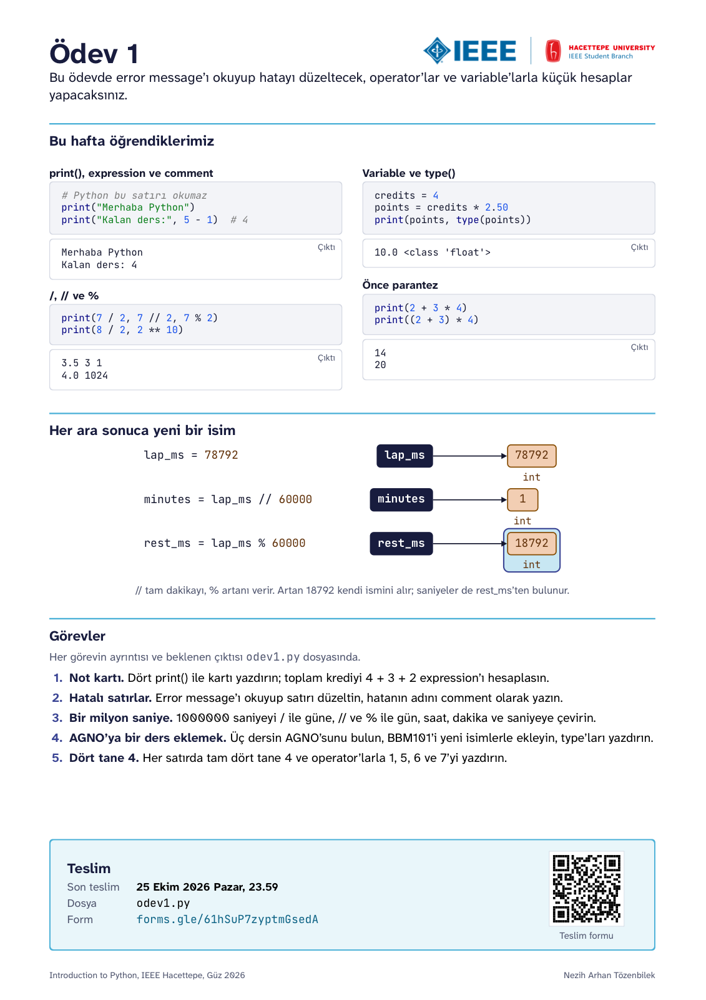
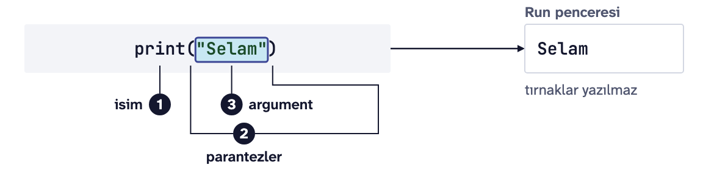
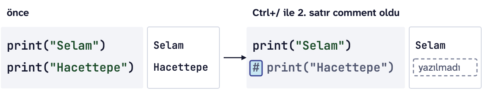
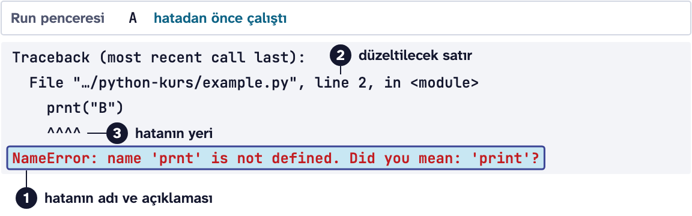
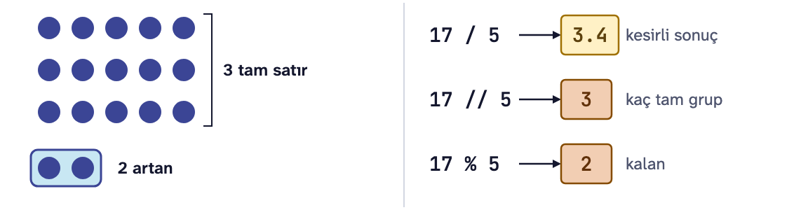
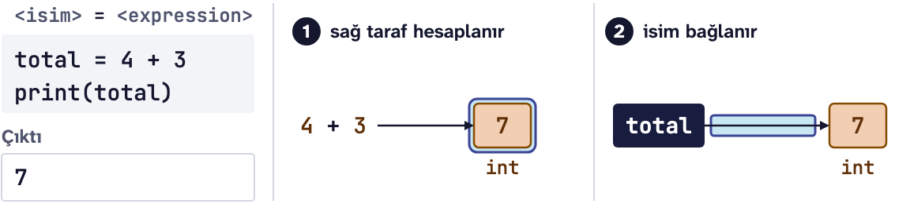

# Ödev 1: Bir milyon saniye

IEEE Hacettepe **Introduction to Python** dersinin 1. ödevi, Güz 2026.

<p align="center"></p>

Yukarıdaki kart bu haftanın özeti. Aşağıda aynı konuların daha ayrıntılı tekrarı var.

**İndirmek için:** yeşil **Code** düğmesine basın, **Download ZIP** deyin, zip'i açın. Git bilmenize gerek yok.

**Son teslim:** 25 Ekim 2026 Pazar, 23.59
**Teslim:** [Ödev 1 teslim formu](https://forms.gle/61hSuP7zyptmGsedA)

Bu ödevin sonunda error message'ı (hata mesajı) okuyup hatayı düzeltebilecek, aritmetik operator'lar (işlemciler) ve variable'larla (değişkenler) küçük hesaplar yapabileceksiniz.

## Bu ödevde kullanacaklarımız

### print() ve string
`print()` içine verdiğiniz her şeyi ekrana yazar. Tırnak içindeki yazı bir string'dir. Virgülle ayırdığınız değerlerin arasına `print()` kendisi bir boşluk koyar.

```python
print("Merhaba")          # Merhaba
print("Yaş:", 20)         # Yaş: 20
```



### Comment
`#` işaretinden sonra satırın sonuna kadar yazılanları Python çalıştırmaz. Kodun yanına not düşmek için kullanılır.

```python
print("Selam")  # bu kısım ekrana gelmez
```



### Error message (hata mesajı)
Kod çalışmazsa Python bir error message yazar. En önemli satırı sonuncusudur: hatanın adını ve sebebini söyler.

```text
NameError: name 'pirnt' is not defined
```



Derste gördüğümüz üç hata:

| Hata | Ne zaman çıkar | Örnek |
|---|---|---|
| `SyntaxError` | Yazım kuralı bozulduğunda: kapanmayan tırnak ya da parantez | `print("Selam)` |
| `NameError` | Python'ın tanımadığı bir isim kullanıldığında | `pirnt("Selam")` |
| `TypeError` | Birbiriyle işlem yapılamayan iki value'yu birleştirince | `"Yaş: " + 20` |

Dosyada bir `SyntaxError` varsa Python hiçbir satırı çalıştırmaz, önce o satırı düzeltmeniz gerekir.

### Value (değer) ve type (tip)
Her value'nun bir type'ı vardır. `type()` onu gösterir.

```python
print(type(7))        # <class 'int'>    tam sayı
print(type(7.5))      # <class 'float'>  ondalıklı sayı
print(type("7"))      # <class 'str'>    yazı
```


### Aritmetik operator'lar (işlemciler)

| Operator | Ne yapar | Örnek | Sonuç |
|---|---|---|---|
| `+` `-` `*` | toplama, çıkarma, çarpma | `7 * 2` | `14` |
| `/` | bölme, sonuç **her zaman float** | `7 / 2` | `3.5` |
| `//` | bölmenin tam kısmı | `7 // 2` | `3` |
| `%` | bölmeden kalan | `7 % 2` | `1` |
| `**` | üs alma | `2 ** 3` | `8` |

`/` iki tam sayıyı bölse bile float verir: `8 / 2` sonucu `4.0`'dır, `4` değil. Sonucun tam sayı kalmasını istiyorsanız `//` kullanın.

`//` ile `%` birlikte bir süreyi parçalara ayırmanın klasik yoludur. 100 dakikanın kaç saat kaç dakika olduğu:

```python
print(100 // 60)   # 1   (tam saat)
print(100 % 60)    # 40  (artan dakika)
```



İşlem sırası matematikteki gibidir: önce `**`, sonra `*` `/` `//` `%`, en son `+` `-`. Sırayı değiştirmek için parantez kullanın: `(2 + 3) * 4` sonucu `20`'dir, `2 + 3 * 4` ise `14`.

### Variable (değişken) ve assignment (atama)
`=` sağdaki expression'ın (ifade) value'sunu hesaplar ve soldaki isme bağlar.

```python
width = 4
height = 3
area = width * height
print("Alan:", area)       # Alan: 12
```



İsimler küçük harfle ve kelimeler alt çizgiyle yazılır: `total_seconds`, `new_points`. Bir ismin value'sunu sonradan değiştirmeyi Ders 2'de göreceğiz; bu ödevde her ara sonuca yeni bir isim verin.

## Görevler

Görevlerin ayrıntısı ve her birinin beklenen çıktısı `odev1.py` dosyasının içinde.

1. **Not kartı:** Dört `print()` ile bir not dökümü kartı yazdıracaksınız. Toplam krediyi bir expression hesaplayacak.
2. **Hatalı satırlar:** Hatalı üç satırı çalıştırıp error message'ı okuyacak, düzeltecek ve hatanın adını comment olarak yazacaksınız.
3. **Bir milyon saniye:** 1000000 saniyenin kaç gün ettiğini `/` ile, kaç gün saat dakika saniye ettiğini `//` ve `%` ile bulacaksınız.
4. **AGNO'ya bir ders eklemek:** Üç dersin toplam kredisini ve AGNO'sunu hesaplayıp yeni bir ders ekleyeceksiniz.
5. **Dört tane 4:** Her satırda tam dört tane 4 ile 1, 5, 6 ve 7'yi yazdıracaksınız.

Zorunlu olmayan bir **Meraklısına** görevi de var.

Sadece Ders 1'de gördüğümüz yapıları kullanın.

## Nasıl çalışılır

1. Zip'ten çıkan `odev1.py` ve `kontrol.py` dosyalarını aynı klasörde tutun ve `odev1.py`'yi PyCharm'da açın.
2. Her görevde `# TODO` satırının yerine kodunuzu yazın.
3. Dosyayı **Run** ile çalıştırın ve çıktıyı görevin "Beklenen çıktı" kısmıyla karşılaştırın.

## Kendi kendinize kontrol

Bitirince `kontrol.py`'yi PyCharm'da açıp **Run** deyin. Her görev için geçti ya da kaldı yazar, kaldıysa beklenen satırı ve sizin satırınızı gösterir. Kontrol not vermez, sadece size yol gösterir.

## Teslim

[Ödev 1 teslim formunda](https://forms.gle/61hSuP7zyptmGsedA) "İsim" alanına isminizi yazın, `odev1.py`'yi "Ödev dosyası" alanına yükleyin ve onay kutusunu işaretleyin.

Takıldığınız bir yer olursa dersin WhatsApp grubuna yazın.

Dersin sitesi: https://natozenbilek.github.io/ieee-hacettepe-python-course/
